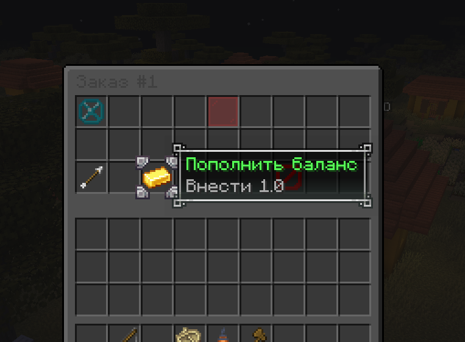

# Service system

## What is the service system?

The service system lets players create jobs for other players. For example, you can request concrete, set a budget and describe the task.

## How do I add money to an order?

After funding an order, the system searches for an executor. You can cancel while nobody has accepted it. If an executor has already accepted, both sides must agree to cancel.

After a successful deal, the executor receives 80% of the payment.

::: warning Important
Always agree on the order details and payment with the executor in advance.
:::
